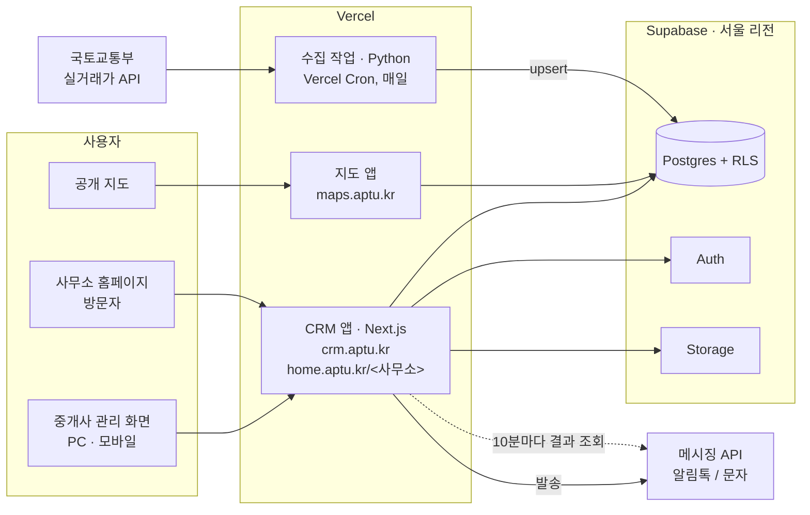

# AptU(아파트U) — 1인 부동산 중개사무소를 위한 CRM · 실거래가 플랫폼

[English](README.md) · **한국어**

> 더블더블소프트의 첫 사업으로, 제가 혼자 기획·개발·운영하는 서비스의 케이스 스터디입니다.
> 소스 코드는 비공개이며, 이 저장소에는 아키텍처와 백엔드 설계 결정을 정리했습니다.

**서비스:** [maps.aptu.kr](https://maps.aptu.kr) · [aptu.kr](https://aptu.kr)

---

## 요약

- **무엇을:** 1인 부동산 중개사무소를 위한 멀티테넌트 SaaS입니다. 고객 관리(CRM), 일정 관리, 카카오 알림톡 발송, 공개 아파트 실거래가 지도, 사무소별 홈페이지를 제공합니다.
- **역할:** 창업자이자 유일한 개발자로 데이터 파이프라인, 데이터 모델, 백엔드, 메시징 연동, 인프라, 프론트엔드, 약관·개인정보 설계를 모두 맡았습니다.
- **백엔드 주요 내용:**
  - 22개 지역 1,427개 아파트 단지의 국토교통부 실거래가를 매일 수집합니다. 다시 수집해도 결과가 같은 upsert 구조라서 뒤늦은 해제 신고도 반영됩니다.
  - 사무소 ID 기준 Postgres RLS(행 단위 보안)로 테넌트를 격리합니다.
  - 메시징 파이프라인은 발송 결과 조회, 문자 대체 발송, 월 발송 한도, 수신 동의 주기 관리를 갖췄습니다.
  - 개인정보는 최소한만 저장하고, 모든 데이터를 국내에 보관합니다.

## 아키텍처

| 구성 | 기술 |
|---|---|
| CRM · 사무소 홈페이지 | Next.js 15(App Router), React 19, TypeScript. 하나의 앱이며, `home.aptu.kr/<사무소>`는 미들웨어의 호스트 리라이트로 처리합니다 |
| 지도 | 순수 JavaScript(번들러 없음) + Vercel 서버리스 함수(Node.js, Python) |
| 소개 사이트 | Astro |
| 호스팅 · 예약 작업 | Vercel, Vercel Cron |
| DB · 인증 · 스토리지 | Supabase(Postgres), 서울 리전 |
| 메시징 | 카카오 알림톡(메시징 API 연동), 문자 대체 발송 |
| 데이터 출처 | 국토교통부 아파트 실거래가 |
| 지도 | 네이버 지도(카카오맵 버전 별도) |

## 백엔드 설계

### 1. 실거래가 데이터 파이프라인
국토교통부 API는 거래 식별자가 없고, 해제 신고가 몇 주 뒤 별도 행으로 들어오기도 합니다.

- **수집:** Vercel Cron이 매일 04:00(KST)에 최근 3개월을, 일요일에는 늦은 해제 신고를 잡기 위해 24개월을 다시 수집합니다.
- **매칭:** 단지명이 아니라 국토교통부 단지 ID(`aptSeq`)를 키로 써서 1,427개 단지를 정확히 매칭합니다.
- **멱등성:** 해제 여부를 뺀 식별 필드의 SHA-1 해시를 키로 upsert합니다. 나중에 들어온 해제 신고는 기존 행을 갱신하고, 최초 수집 시각은 유지되어 "새 거래" 표시에 쓰입니다.
- **지도 데이터 제공:** 공간 인덱스 대신 지역 단위 JSON(약 200KB)을 RPC 한 번으로 내려주고, 클라이언트는 화면에 보이는 지역만 불러옵니다.

### 2. 메시징 파이프라인
- **사람이 최종 확인:** 시스템이 보낼 메시지(집 보기 일정, 조건에 맞는 새 매물, 관심 단지 실거래)를 계산하고, 발송은 중개사가 확인해야 이뤄집니다.
- **발송 결과:** cron이 10분마다 결과를 조회해 알림톡 전달, 문자 대체, 실패를 기록합니다. 상태가 "보냄"인 행만 갱신해 사람이 수정한 내용을 덮어쓰지 않습니다.
- **발송 한도:** 사무소당 월 100건이며, 한도를 넘는 묶음은 통째로 거절합니다. 건수를 읽지 못하면 발송하지 않습니다.
- **수신 동의 주기:** 알림 신청은 6개월, 광고 수신 동의는 2년마다 갱신하며, 기한이 다가오는 고객을 따로 보여 줍니다.

### 3. 고객 요청 접수
홈페이지 양식으로 들어온 요청은 AI 모델 jev가 스팸·장난 요청을 걸러낸 뒤 검토 대기열에 쌓이고, 중개사가 하나씩 승인해야 고객으로 등록됩니다.

### 4. 개인정보 보호 중심 설계
고객 정보는 이름, 전화번호, 관심 조건, 상담 기록만 저장하고(주민등록번호·주소 제외), 모든 데이터는 서울 리전에 보관합니다. 이용약관, 개인정보처리방침, 처리위탁 계약서는 직접 작성했습니다.

### 5. AI 자동 분류 버그 추적 시스템
테스터와 함께 쓰는 이슈 추적 시스템(Apt U Todo)에서 "자동 분류"를 누르면 AI 모델 jev가 종류, 우선순위, 영역을 추천하고, 작성자가 확인한 뒤 저장합니다.

## 화면

| 지도 상담 | 고객 관리 |
|---|---|
|  |  |

| 월간 일정 | 발송 내역 |
|---|---|
|  |  |

| 이슈 목록 | 새 이슈 자동 분류 |
|---|---|
|  |  |

모든 기능은 PC와 모바일에서 동작합니다. 중개사는 방문한 손님에게 지도를 보여 주며 상담하고, 일정·매물 알림톡을 보내고, 블로그에 쓸 실거래가 표와 이미지를 복사합니다. 방문 통계로는 알림톡과 블로그 글을 통한 홈페이지 유입을 확인합니다.

---

**연락처:** Younggi Lim · [javawork93@gmail.com](mailto:javawork93@gmail.com) · [LinkedIn](https://www.linkedin.com/in/younggi/)
