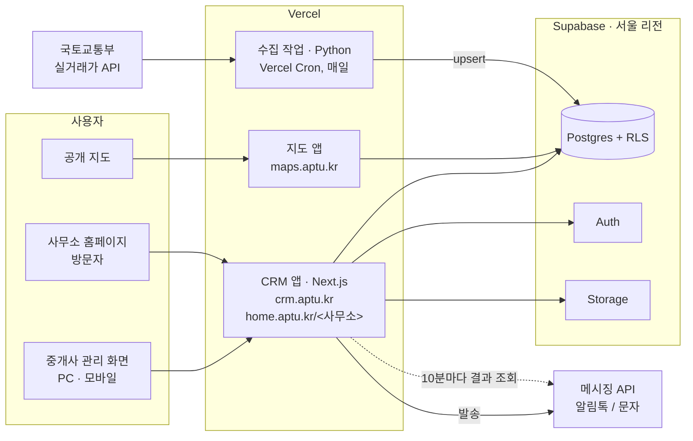
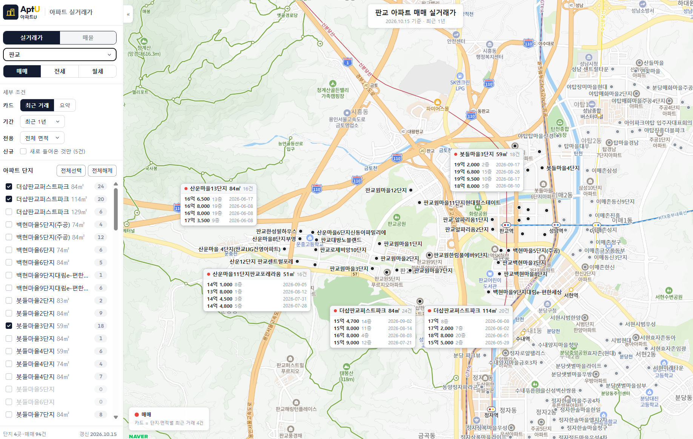
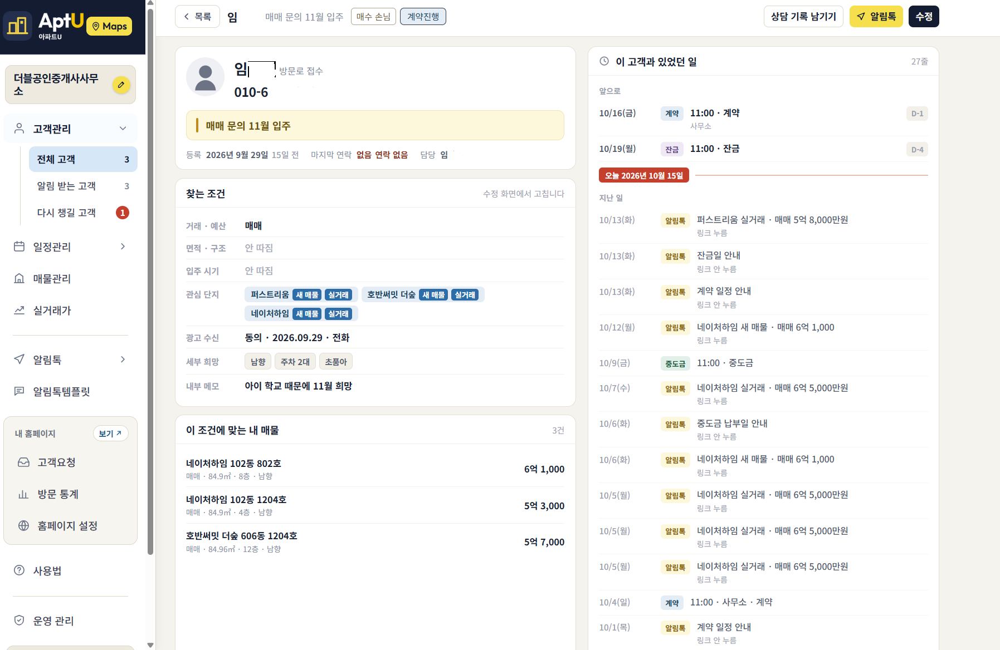
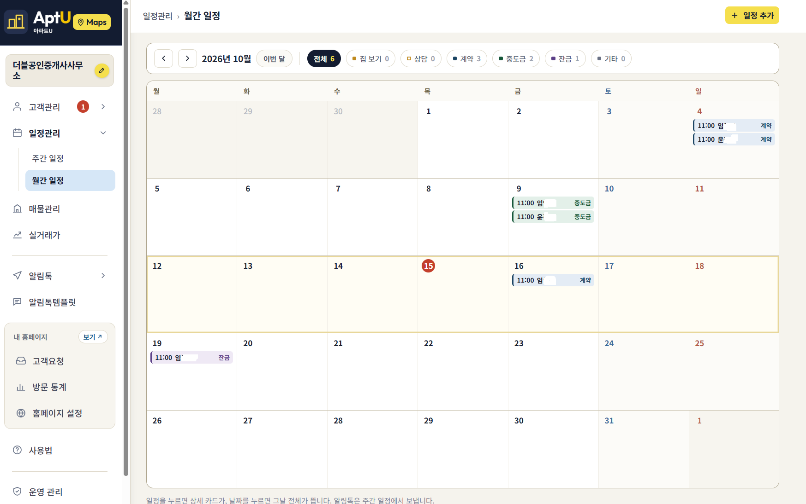
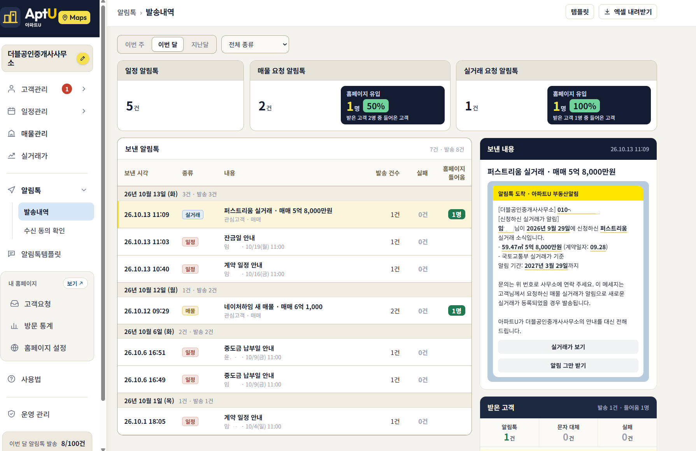

# AptU(아파트U) — 1인 부동산 중개사무소를 위한 CRM · 실거래가 플랫폼

[English](README.md) · **한국어**

> 더블더블소프트의 첫 사업으로, 제가 혼자 기획·개발·운영하는 서비스의 케이스 스터디입니다.
> 소스 코드는 비공개이며, 이 저장소에는 아키텍처와 백엔드 설계 결정을 정리했습니다.

**서비스:** [maps.aptu.kr](https://maps.aptu.kr) · [aptu.kr](https://aptu.kr)

---

## 요약

- **무엇을:** 1인 부동산 중개사무소를 위한 멀티테넌트 SaaS입니다. 고객 관리(CRM), 일정 관리, 카카오 알림톡 발송, 공개 아파트 실거래가 지도, 사무소별 홈페이지를 제공합니다.
- **역할:** 창업자이자 유일한 개발자로 데이터 파이프라인, 데이터 모델, 백엔드, 메시징 연동, 인프라, 프론트엔드, 약관·개인정보 설계를 모두 맡았습니다.
- **백엔드 주요 내용:**
  - 22개 지역 1,427개 아파트 단지의 국토교통부 실거래가를 매일 수집합니다. 다시 수집해도 결과가 같은 upsert 구조라서 뒤늦은 해제 신고도 반영됩니다.
  - 사무소 ID 기준 Postgres RLS(행 단위 보안)로 테넌트를 격리합니다.
  - 메시징 파이프라인은 발송 결과 조회, 문자 대체 발송, 월 발송 한도, 수신 동의 주기 관리를 갖췄습니다.
  - 개인정보는 최소한만 저장하고, 모든 데이터를 국내에 보관합니다.
- **현황:** 중개사무소 한 곳에서 매일 사용 중이며, 다른 사무소에도 오픈하고 있습니다(2026년 10월 기준).

## 아키텍처

| 구성 | 기술 |
|---|---|
| CRM · 사무소 홈페이지 | Next.js 15(App Router), React 19, TypeScript. 하나의 앱이며, `home.aptu.kr/<사무소>`는 미들웨어의 호스트 리라이트로 처리합니다 |
| 지도 | 순수 JavaScript(번들러 없음) + Vercel 서버리스 함수(Node.js, Python) |
| 소개 사이트 | Astro |
| 호스팅 · 예약 작업 | Vercel, Vercel Cron |
| DB · 인증 · 스토리지 | Supabase(Postgres), 서울 리전 |
| 메시징 | 카카오 알림톡(메시징 API 연동), 문자 대체 발송 |
| 데이터 출처 | 국토교통부 아파트 실거래가 |
| 지도 | 네이버 지도(카카오맵 버전 별도) |

## 백엔드 설계

### 1. 실거래가 데이터 파이프라인
국토교통부 API는 지역 코드와 월 단위로만 조회할 수 있습니다. 거래 식별자가 없고, 처음 공개된 뒤 몇 주가 지나 해제 신고가 들어오기도 하며, 해제 신고가 별도의 중복 행으로 내려오는 경우도 있습니다.

- **수집 일정:** Vercel Cron이 매일 04:00(KST)에 실행됩니다. 월~토요일에는 30일 신고 기한을 감안해 최근 3개월을, 일요일에는 늦은 해제 신고를 잡기 위해 24개월을 다시 수집합니다. 수동 백필은 최대 120개월까지 가능합니다.
- **수집 범위:** 경기·인천·서울 22개 지역(지역 코드 18개)에서 직접 고른 1,427개 단지입니다. 목록에 있는 모든 지역 코드에 대해 매매 API와 전월세 API를 모두 호출하고, 목록에 있는 단지의 거래만 남깁니다.
- **단지 매칭:** 단지명이 아니라 국토교통부의 단지 ID(`aptSeq`)를 키로 씁니다. 단지명 정규화는 목록에 단지를 추가할 때 ID를 찾는 보조 스크립트에서만 한 번 합니다.
- **정규화:** 매매와 전월세 응답을 하나의 레코드 형태로 통일합니다. `"60,000"` 같은 금액 문자열은 정수로 바꾸고, 해제 여부와 해제일을 파싱합니다.
- **멱등성:** 거래를 식별하는 필드들의 SHA-1 해시로 레코드마다 고정된 키를 만듭니다. 해제 여부는 일부러 해시에서 빼서, 나중에 들어온 해제 신고가 기존 행을 갱신하도록 했습니다. 한 응답 안의 중복 행은 정보가 가장 많은 행으로 합친 뒤, PostgREST의 `on_conflict=row_key`로 upsert합니다. 최초 수집 시각은 재수집 때도 유지되어 "새 거래" 표시에 쓰입니다. 매 실행은 로그로 남깁니다.
- **지도 데이터 제공:** 공간 인덱스 대신 지역 단위로 데이터를 내려줍니다. RPC 한 번으로 한 지역의 데이터를 JSON 하나(약 200KB)로, 지역별 경계 박스와 함께 반환합니다. 클라이언트는 화면에 보이는 지역만 불러오고, 많이 축소했을 때는 불러오지 않습니다. 단지별 실거래가 표는 `(apt_seq, deal_date desc)` 인덱스를 씁니다.
- **범위 제한:** 대상을 아파트로 한정해 매칭이 항상 정확하게 이뤄지도록 했습니다.

### 2. 메시징 파이프라인
- **사람이 최종 확인:** 시스템은 보낼 메시지를 계산합니다(내일 집 보기 일정, 고객 요청에 맞는 새 매물, 관심 단지의 새 실거래). 실제 발송은 중개사가 확인해야만 이뤄집니다.
- **발송 결과:** 발송 API의 응답은 "접수"까지입니다. cron이 10분마다 결과를 모르는 메시지를 메시징 업체에 조회해 알림톡 전달, 문자 대체 전달, 실패 중 하나로 기록합니다. 상태가 여전히 "보냄"인 행만 갱신해서, 그 사이 사람이 수정한 내용을 덮어쓰지 않습니다. 72시간이 지나면 더 조회하지 않습니다. 문자 대체와 실패 응답은 아직 운영 환경에서 관찰되지 않아, 업체의 원본 상태 코드도 함께 저장합니다.
- **발송 한도:** 사무소마다 매월(서울 시간 기준) 알림톡 100건입니다. 남은 건수를 넘는 발송 묶음은 일부만 보내지 않고 통째로 거절해, 누구에게 나갔는지 헷갈리지 않게 했습니다. 이번 달 건수를 읽지 못하면 발송하지 않습니다. 발송은 되돌릴 수 없기 때문입니다.
- **수신 동의 주기:** 알림 신청은 신청일부터 6개월 뒤 만료되고, 광고 수신 동의는 2년마다 다시 확인받습니다. 알림 신청이 끝나면 광고 수신 동의도 함께 끝나며, "수신 동의 확인" 탭에서 기한이 다가오는 고객을 보여 줍니다.
- **발신 채널 단일화:** 모든 사무소가 하나의 발신 채널을 써서, 가입할 때 사무소별 채널 등록과 템플릿 심사가 필요 없습니다.
- **측정 가능한 것만 성과로:** 전달 상태와 홈페이지 유입 링크 클릭만 집계합니다. 읽음 여부나 오프라인 전환은 주장하지 않습니다.

### 3. 고객 요청 접수
홈페이지 양식(문의, 매물 접수, 매물 알림, 실거래가 알림)으로 들어온 요청은 검토 대기열에 쌓이고, 관리 화면에 미처리 건수가 표시됩니다. 자동으로 고객 등록되는 요청은 없고 중개사가 하나씩 승인합니다. 덕분에 스팸이나 잘못된 입력이 CRM과 메시징 파이프라인에 들어오지 않습니다. 처리 완료되거나 등록하지 않은 요청은 6개월 뒤 삭제됩니다.

### 4. 개인정보 보호 중심 설계
- 고객 정보는 이름, 전화번호, 관심 조건, 상담 기록만 저장합니다. 주민등록번호와 주소는 저장하지 않습니다.
- 선택 항목은 업무상 꼭 필요한 곳에만 둡니다.
- 모든 데이터는 국내(서울 리전)에 저장하며, 국외로 이전하지 않습니다.
- 각 사무소가 개인정보처리자, 더블더블소프트가 수탁자이며, 가입할 때 동의하는 처리위탁 계약에 따릅니다. 이용약관, 개인정보처리방침, 위탁 계약서는 제가 직접 작성했습니다.

## 화면

| 지도 상담 | 고객 관리 |
|---|---|
|  |  |

| 월간 일정 | 발송 내역 |
|---|---|
|  |  |

모든 기능은 PC와 모바일에서 동작합니다. 중개사는 방문한 손님에게 지도를 보여 주며 상담하고, 일정·매물 알림톡을 보내고, 블로그에 쓸 실거래가 표와 이미지를 복사합니다. 방문 통계로는 알림톡과 블로그 글을 통한 홈페이지 유입을 확인합니다.

---

**연락처:** Younggi Lim · [javawork93@gmail.com](mailto:javawork93@gmail.com) · [LinkedIn](https://www.linkedin.com/in/younggi/)
