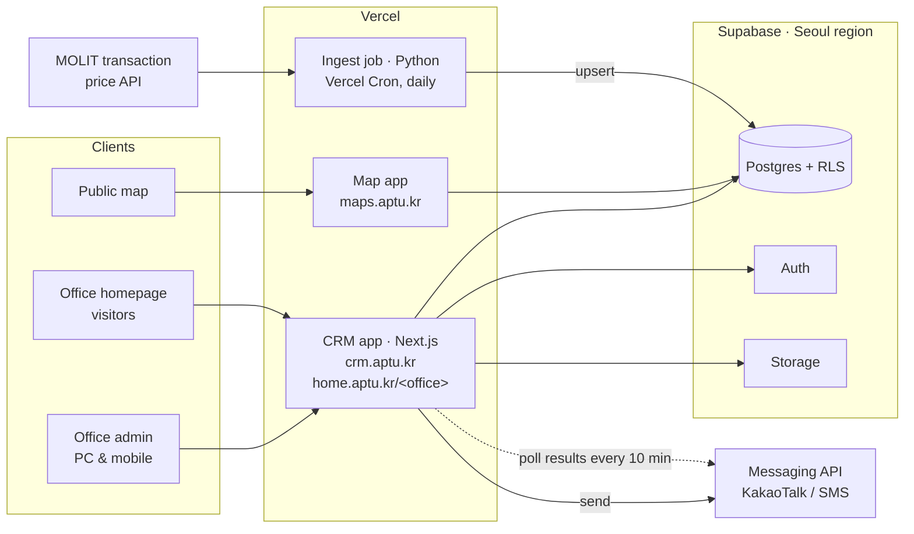

# AptU — CRM & Transaction-Price Platform for Small Real Estate Offices

**English** · [한국어](README.ko.md)

> Case study of a product I designed, built, and operate solo as the first business of DoubleDouble Soft.
> Source code is private; this repository documents the architecture and backend design decisions.

**Live:** [maps.aptu.kr](https://maps.aptu.kr) · [aptu.kr](https://aptu.kr)

---

## Summary

- **What:** A multi-tenant SaaS for one-person real estate offices in Korea — CRM, scheduling, KakaoTalk business messaging, a public apartment transaction-price map, and a homepage per office.
- **My role:** Sole engineer and founder — data pipeline, data model, backend, messaging integration, infrastructure, frontend, and the legal/privacy design.
- **Backend highlights:**
  - Daily ingest of government transaction-price data for 1,427 apartment complexes across 22 districts, with idempotent upserts that pick up late cancellation reports
  - Multi-tenant isolation with Postgres row-level security keyed on office ID
  - Messaging pipeline with delivery-result polling, SMS fallback, monthly quotas, and consent lifecycle
  - Privacy-minimal data model; all data hosted in Korea

## Architecture

| Layer | Technology |
|---|---|
| CRM & office homepages | Next.js 15 (App Router), React 19, TypeScript — one app; `home.aptu.kr/<office>` is a host rewrite in middleware |
| Map | Plain JavaScript (no bundler) + Vercel serverless functions (Node.js, Python) |
| Marketing site | Astro |
| Hosting / scheduled jobs | Vercel, Vercel Cron |
| Database / Auth / Storage | Supabase (Postgres), Seoul region |
| Messaging | KakaoTalk business messages via a messaging API, SMS fallback |
| Data source | Ministry of Land, Infrastructure and Transport (MOLIT) real transaction data |
| Maps | Naver Maps (alternate Kakao Maps build) |

## Backend design

### 1. Transaction-price data pipeline
The MOLIT API has no transaction IDs, and cancellations can arrive weeks later as separate rows.

- **Ingest:** Vercel Cron re-fetches the last 3 months daily at 04:00 KST, and 24 months on Sundays to catch late cancellations.
- **Matching:** 1,427 complexes are keyed on MOLIT's complex ID (`aptSeq`), not names, so matching is exact.
- **Idempotency:** rows are upserted on a SHA-1 hash of identifying fields, excluding the cancellation flag, so late cancellations update the existing row. First-seen timestamps survive re-ingest and drive the "new transaction" flag.
- **Serving the map:** instead of a spatial index, one RPC returns a district as a single JSON payload (about 200 KB); the client loads only districts in the viewport.

### 2. Messaging pipeline
- **Human in the loop:** the system computes which messages are due (viewings, matching listings, new transactions in watched complexes); the agent confirms before anything is sent.
- **Delivery results:** a cron job polls every 10 minutes and records KakaoTalk delivery, SMS fallback, or failure, updating only rows still marked "sent" so manual edits aren't overwritten.
- **Quotas:** 100 messages per office per month. Batches over the remaining quota are rejected whole, and nothing is sent if the count can't be read.
- **Consent lifecycle:** alert subscriptions expire after 6 months and advertising consent is reconfirmed every 2 years, with customers coming due listed separately.

### 3. Request intake
Homepage form submissions are screened by the AI model jev for spam and pranks, then wait in a review queue; nothing becomes a customer until the agent approves it.

### 4. Privacy by design
Customer records hold only name, phone, interests, and consultation notes (no resident registration number or address), and all data stays in the Seoul region. I wrote the terms of service, privacy policy, and data-processing agreement.

### 5. Bug tracker with AI triage
In Apt U Todo, the issue tracker I use with testers, "Auto-classify" has the AI model jev suggest type, priority, and area; the writer reviews the suggestions before saving.

## Product

| Map consultation | Customer management |
|---|---|
|  |  |

| Monthly schedule | Message history |
|---|---|
|  |  |

| Issue list | New issue with AI triage |
|---|---|
|  |  |

Every feature works on mobile as well as PC. Agents show the map to walk-in customers, send schedule and listing notifications, and copy price tables and images for their blogs; visit statistics show homepage traffic from notifications and blog posts.

---

**Contact:** Younggi Lim · [javawork93@gmail.com](mailto:javawork93@gmail.com) · [LinkedIn](https://www.linkedin.com/in/younggi/)
