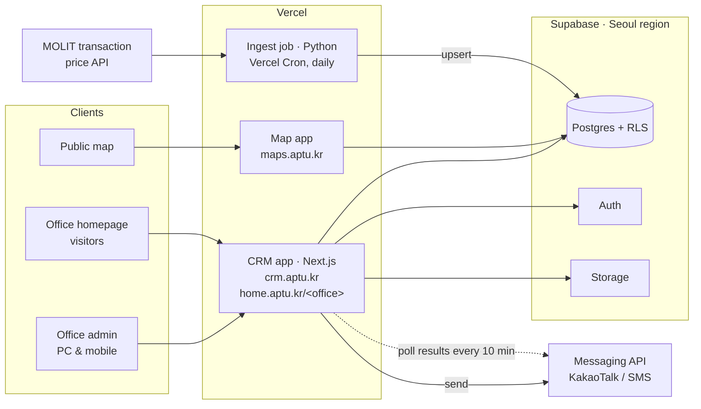
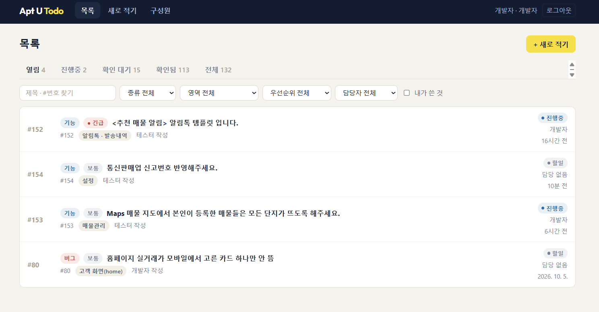
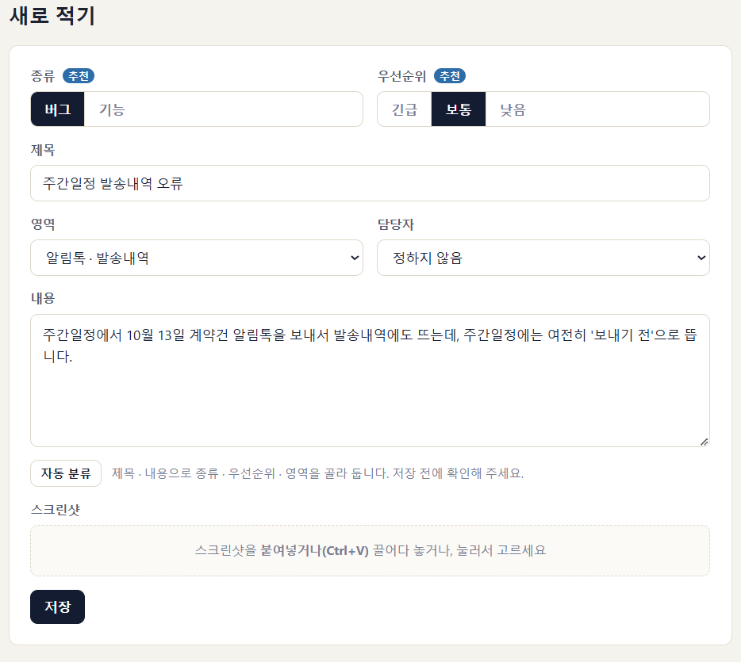

# AptU — CRM & Transaction-Price Platform for Small Real Estate Offices

**English** · [한국어](README.ko.md)

> Case study of a product I designed, built, and operate solo as the first business of DoubleDouble Soft.
> Source code is private; this repository documents the architecture and backend design decisions.

**Live:** [maps.aptu.kr](https://maps.aptu.kr) · [aptu.kr](https://aptu.kr)

---

## Summary

- **What:** A multi-tenant SaaS for one-person real estate offices in Korea — CRM, scheduling, KakaoTalk business messaging, a public apartment transaction-price map, and a homepage per office.
- **My role:** Sole engineer and founder — data pipeline, data model, backend, messaging integration, infrastructure, frontend, and the legal/privacy design.
- **Backend highlights:**
  - Daily ingest of government transaction-price data for 1,427 apartment complexes across 22 districts, with idempotent upserts that pick up late cancellation reports
  - Multi-tenant isolation with Postgres row-level security keyed on office ID
  - Messaging pipeline with delivery-result polling, SMS fallback, monthly quotas, and consent lifecycle
  - Privacy-minimal data model; all data hosted in Korea
- **Status:** In daily use by one office; opening to more offices (as of October 2026).

## Architecture

| Layer | Technology |
|---|---|
| CRM & office homepages | Next.js 15 (App Router), React 19, TypeScript — one app; `home.aptu.kr/<office>` is a host rewrite in middleware |
| Map | Plain JavaScript (no bundler) + Vercel serverless functions (Node.js, Python) |
| Marketing site | Astro |
| Hosting / scheduled jobs | Vercel, Vercel Cron |
| Database / Auth / Storage | Supabase (Postgres), Seoul region |
| Messaging | KakaoTalk business messages via a messaging API, SMS fallback |
| Data source | Ministry of Land, Infrastructure and Transport (MOLIT) real transaction data |
| Maps | Naver Maps (alternate Kakao Maps build) |

## Backend design

### 1. Transaction-price data pipeline
The MOLIT API is queried per area code and month. Records carry no transaction ID, and a deal can be reported as cancelled weeks after it first appears, sometimes as a separate duplicate row.

- **Schedule:** Vercel Cron runs daily at 04:00 KST. Monday–Saturday it re-fetches the last 3 months, which covers the 30-day reporting deadline; on Sunday it re-fetches 24 months to catch late cancellations. A manual backfill goes back up to 120 months.
- **Coverage:** 1,427 hand-curated complexes in 22 districts across Gyeonggi, Incheon, and Seoul (18 area codes). The job fetches every area code in the list, calls both the sale and the jeonse/monthly-rent APIs, and keeps only rows for listed complexes.
- **Matching:** complexes are keyed on MOLIT's own complex ID (`aptSeq`), not on names. Names are normalized only once, in a helper that looks up the ID when a complex is added to the list.
- **Normalization:** sale and rent responses are unified into one record shape, with amounts like `"60,000"` converted to integers and cancellation flags and dates parsed.
- **Idempotency:** each record gets a deterministic key, a SHA-1 hash of its identifying fields. The cancellation flag is deliberately left out of the hash, so a later cancellation report updates the existing row. Duplicates within one response are merged, keeping the most informative row, before upserting through PostgREST with `on_conflict=row_key`. First-seen timestamps survive re-ingest and drive the "new transaction" flag. Every run is logged.
- **Serving the map:** instead of a spatial index, data is served per district. One RPC returns a district's data as a single JSON payload (about 200 KB) along with district bounding boxes. The client loads only the districts in the viewport and skips loading at low zoom. Per-complex price tables use an `(apt_seq, deal_date desc)` index.
- **Scope:** limited to apartments by design, which keeps matching exact.

### 2. Messaging pipeline
- **Human in the loop:** the system computes which messages are due (tomorrow's viewing, a new listing matching a customer's request, a new transaction in a watched complex), but sends only when the agent confirms.
- **Delivery results:** the send API acknowledges only receipt. Every 10 minutes a cron job polls the messaging provider for messages whose outcome is still unknown, then records whether each was delivered by KakaoTalk, delivered by SMS fallback, or failed. Updates only touch rows still in the "sent" state, so manual edits made in between aren't overwritten. Polling stops after 72 hours. The provider's raw status code is stored, because the SMS-fallback and failure responses had not yet been observed in production.
- **Quotas:** each office gets 100 KakaoTalk messages per calendar month, counted in Seoul time. A batch that exceeds the remaining quota is rejected whole rather than partially sent, so it's always clear who received a message. If the count can't be read, nothing is sent, since sends are irreversible.
- **Consent lifecycle:** alert subscriptions expire 6 months after signup and advertising consent must be reconfirmed every 2 years. Ending a subscription also ends its advertising consent, and a "consent check" tab lists the customers coming due.
- **Single sender channel** for all tenants, removing per-tenant channel registration and template review from onboarding.
- **Attribution limited to what is observable:** delivery status and link clicks into the homepage, with no claims of read receipts or offline conversions.

### 3. Request intake
Homepage forms (inquiries, property listing requests, listing alerts, price alerts) go into a review queue with an unprocessed count in the admin. Nothing is auto-registered as a customer; the agent approves each request, which keeps spam and mistaken entries out of the CRM and the messaging pipeline. Processed and declined requests are deleted after 6 months.

### 4. Privacy by design
- Customer records hold only name, phone, interests, and consultation notes, with no resident registration number and no address.
- Optional fields appear only where a business process requires them.
- All data is stored in Korea (Seoul region), with no transfer abroad.
- Each office is the data controller and DoubleDouble Soft the processor, under a data-processing agreement accepted at signup. I wrote the terms of service, privacy policy, and agreement.

### 5. Bug tracker with AI triage
To run the service, I built a small issue tracker, Apt U Todo, where testers and I record bugs and feature requests.
- **Auto-classification:** after the title and description are written, "Auto-classify" sends them to the AI model jev, which suggests the type (bug or feature), the priority (urgent, normal, or low), and the area of the product (for example, KakaoTalk messages, settings, listings, or the office homepage).
- **Human in the loop:** suggested fields are marked "Suggested" and the writer reviews them before saving, the same principle as in the messaging pipeline.
- **Workflow:** issues move from open to in progress, awaiting verification, and verified. The list can be filtered by type, area, priority, assignee, and "written by me", and screenshots can be pasted straight into an issue. It has tracked 132 issues so far (as of October 2026).

## Product

| Map consultation | Customer management |
|---|---|
|  |  |

| Monthly schedule | Message history |
|---|---|
|  |  |

| Issue list | New issue with AI triage |
|---|---|
|  |  |

Every feature works on mobile as well as PC. Agents show the map to walk-in customers, send schedule and listing notifications, and copy price tables and images for their blogs; visit statistics show homepage traffic from notifications and blog posts.

---

**Contact:** Younggi Lim · [javawork93@gmail.com](mailto:javawork93@gmail.com) · [LinkedIn](https://www.linkedin.com/in/younggi/)
